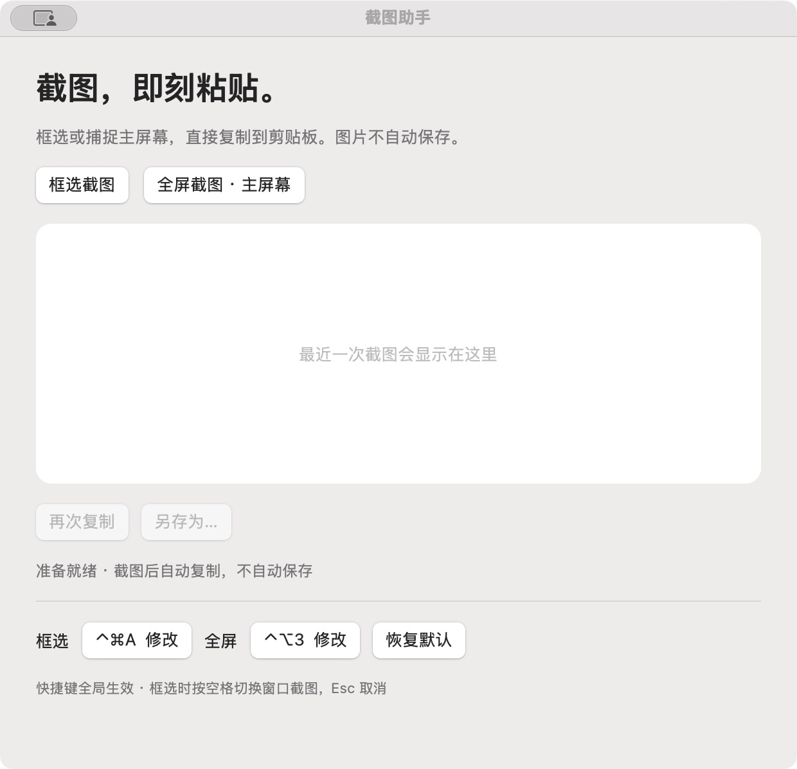

# 截图助手 · Screenshot Helper

轻量的原生 macOS 截图工具，使用 Swift + AppKit 开发。支持框选、窗口和主屏幕截图，截图后自动复制到剪贴板。

## 界面预览



*主界面实拍，底部支持自定义截图快捷键。*

## 系统要求

- Apple Silicon Mac（M 系列芯片 / arm64）
- macOS 13 或更新版本
- 当前发布包不支持 Intel Mac

## 下载安装

1. 前往 [Releases](https://github.com/mossbyte888/screenshot-helper/releases/latest)，下载 `ScreenshotHelper-1.0.2-macOS-arm64.dmg`。
2. 双击打开 DMG，将 **截图助手.app** 拖到窗口中的 **Applications（应用程序）** 文件夹快捷方式。
3. 复制完成后推出“截图助手”磁盘，从 Mac 的“应用程序”文件夹打开软件。
4. 首次截图时，在“系统设置 → 隐私与安全性 → 屏幕与系统音频录制”（部分系统显示为“屏幕录制”）中允许“截图助手”，必要时退出并重新打开。

DMG 内附 MIT 许可证与安装说明。也可下载备用的 `ScreenshotHelper-1.0.2-macOS-arm64.zip`，解压后将应用拖入“应用程序”文件夹。

当前发布包使用本地临时签名，尚未进行 Apple Developer ID 签名或公证，macOS 可能阻止直接打开。确认下载来自本仓库后，可在“系统设置 → 隐私与安全性”中查看系统提供的“仍要打开”选项；也可以按下文自行编译。无需关闭系统安全保护。

## 功能

- **框选截图**：默认 `Control + Option + 2`；拖动框选，按空格切换窗口截图，按 Esc 取消。
- **主屏幕截图**：默认 `Control + Option + 3`。
- **自定义快捷键**：在设置中点击“修改”，按下新组合键，自动保存到本机。
- **剪贴板输出**：截图后直接 `Command + V` 粘贴，不自动保存图片文件。
- **预览与保存**：预览最近一张截图、再次复制，或通过“另存为…”手动保存 PNG。
- **Dock 与菜单栏入口**：点击图标打开窗口，关闭窗口后快捷键继续生效。
- **可缩放窗口**：高分辨率截图按预览区域缩放，不会撑大窗口。

退出请按 `Command + Q`，或从菜单中选择“退出截图助手”。

快捷键需包含 Command、Option、Control 中的至少一个修饰键；两项功能不能设置相同组合键，冲突时会提示。可随时恢复默认设置。

## 隐私与权限

应用不需要登录，不包含网络上传功能，不注册开机启动项。全局快捷键使用系统热键接口，不需要辅助功能权限。

截图通过 macOS 的截图工具直接写入系统剪贴板；应用只在内存中保留最近一张预览。退出会清除应用内预览，系统剪贴板由 macOS 管理。只有点击“另存为…”才会由应用保存 PNG 文件。

如果更新或重新编译后，录屏权限已开却无法截图，可能是系统仍保留旧签名的授权记录。退出应用，在系统录屏权限列表中移除旧条目，重新添加“应用程序”中的新版并授权，然后重新打开。

## 从源码构建

在 Apple Silicon Mac 上安装 Apple Command Line Tools，并确保 `python3` 可用：

```bash
xcode-select --install
git clone https://github.com/mossbyte888/screenshot-helper.git
cd screenshot-helper
bash build.sh
open 截图助手.app
```

构建会在项目目录生成 `截图助手.app` 和 `截图助手.zip`。无需第三方 Swift 依赖。脚本对部分开发工具升级后遗留的重复 SwiftBridging 声明采用临时编译器文件视图，不修改系统工具文件。

已有 `截图助手.app` 后，可进一步生成 DMG 安装包：

```bash
bash build-dmg.sh
```

输出为 `release-assets/ScreenshotHelper-1.0.2-macOS-arm64.dmg`，包含应用、“应用程序”文件夹快捷方式、MIT 许可证和安装说明。脚本同时生成同名的 `.dmg.sha256.txt` 校验文件；ZIP 的 `SHA256SUMS.txt` 保持独立。

| 文件 | 用途 |
| --- | --- |
| `main.swift` | 应用完整源码 |
| `Info.plist` | 应用信息与版本 |
| `AppIcon.icns` | 应用图标 |
| `build.sh` | 编译、签名并生成应用和 ZIP |
| `build-dmg.sh` | 将已有应用打包为 DMG |
| `CHANGELOG.md` | 更新记录 |

## 许可证

使用 [MIT License](LICENSE) 发布，允许使用、修改和商用，须保留版权及许可声明。
